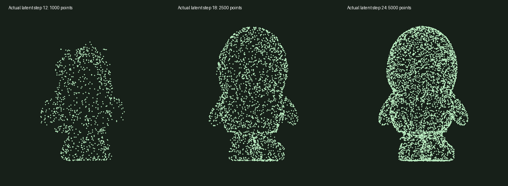
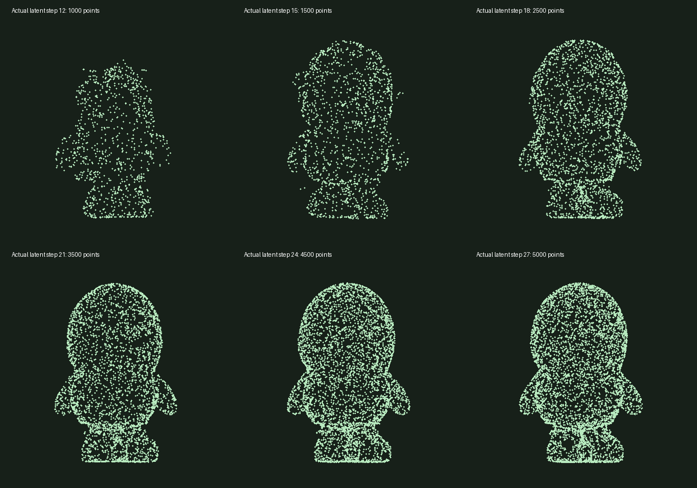

# 多阶段真实点云预览

Java 新任务默认开启三阶段预览。30 步默认计划是：

| 实际完成步数 | VAE 解码分辨率 | 表面采样点数 |
| --- | --- | --- |
| 12 | 64 | 1000 |
| 18 | 96 | 2500 |
| 24 | 128 | 5000 |

三阶段其他采样步数使用 `floor(steps × 0.4/0.6/0.8)`；六阶段使用 `floor(steps × 0.4/0.5/0.6/0.7/0.8/0.9)`，限制到 1～steps-1，重复步数合并，同一步保留较后阶段的较高预算。尊重 Java 原有 previewResolution、pointCount 上限。只有新任务根据当前配置生成计划；已保存的单版、三版或六版任务继续使用自己的参数快照，不根据当前配置重新计算。

## 配置切换（Java）

`formaspace.generation.python-realtime.preview-stage-count` / 环境变量 `REALTIME_PREVIEW_STAGE_COUNT` 默认 **3**，仅接受 3 或 6。设为 6 并重启 Java，可继续使用已验证的六阶段方案：

| 步数（30 步任务） | 分辨率 | 点数 |
| --- | --- | --- |
| 12 | 64 | 1000 |
| 15 | 64 | 1500 |
| 18 | 96 | 2500 |
| 21 | 96 | 3500 |
| 24 | 128 | 4500 |
| 27 | 128 | 5000 |

`REALTIME_MULTI_STAGE_PREVIEW=false` 仍让新任务使用原单阶段配置，`REALTIME_PREVIEW_ENABLED=false` 则关闭预览。Python 保留最多六阶段支持，无需因切换默认方案重启 Python。前端按任务实际版本工作，不需要切换。三阶段开销较低；六阶段验收数据和投影视图继续保留如下。

## 协议和恢复

Python `parameters` 支持可选 `previewStages`，以下为显式六阶段示例（Java 默认发三阶段）：

```json
{"seed":1234,"steps":30,"previewEnabled":true,"previewStages":[{"step":12,"resolution":64,"pointCount":1000},{"step":15,"resolution":64,"pointCount":1500},{"step":18,"resolution":96,"pointCount":2500},{"step":21,"resolution":96,"pointCount":3500},{"step":24,"resolution":128,"pointCount":4500},{"step":27,"resolution":128,"pointCount":5000}]}
```

最多六个阶段，step 必须严格递增且小于 steps，resolution 仅 64/96/128，pointCount 为 1～5000。明确传入计划时不使用 previewStep/previewResolution/pointCount 单阶段参数；未传计划保持原单阶段协议，不自动改变旧客户端。`previewEnabled=false` 不生成预览。

事件协议仍为 v1。每次成功保存递增 previewVersion；失败不占版本。因此 version=1 不一定来自计划第一阶段。每次 preview_ready.sourceStep 和 pointCount 必须与创建任务时持久化的计划匹配，不按固定第 24 步或固定 5000 点校验。

每个成功阶段使用独立 preview_step_NNN.json/PLY 保存。`GET /api/v1/tasks/{id}/previews/{version}` 从持久事件日志查对应版本，完成后仍可读取早期版本。首快照只包含最新成功版本，不做事件历史重播。Java 恢复时按 1～latestVersion 补齐尚未入库的版本，每版独立持久存储；Java 浏览器 HTTP 接口保持原路径和鉴权。

## 真实性和内存边界

每个阶段在采样回调线程里克隆该步真实 `outputs.prev_sample`，经完整 VAE 导出与零等值面提取，再使用局部 RNG 从真实三角面按面积采样。坐标不变，不用最终模型降采样代替早期结果，不把 latent 当 XYZ。预览同步暂停后续采样，并增加总解码开销，不声称减少总推理时间。

预览最多 128 分辨率、5000 点、2000 numChunks，最终解码仍受原 128/256 和任务 numChunks 限制。MPS 临时 decode 引用释放后清 allocator cache，不禁用内存水位保护，不并行解码或同时加载第二模型。普通无表面/解码失败发非致命 preview_failed，保留上一版并继续；设备 OOM、设备异常或全局 RNG 变化按原逻辑终止，不假装预览成功。

## 此前三阶段真实验收（2026-11-18）

使用已有单个 mini/MPS 服务、004.png、seed=1234、30 步、最终 256、numChunks=4000，通过 Java 随机端口原生浏览器 WS 协议与独立 formaspace_multistage_live_test 数据库完成：

- 初始候选 6/15/24 中，第 6 步 64 分辨率解码场约 -0.9976～-0.9932，无真实零等值面，发送 preview_failed 后继续；没有制造早期点云。因此默认调整为 12/18/24。
- 12/18/24 均成功，真实点数 1000/2500/5000；解码耗时约 0.82/2.58/6.06 秒，三个阶段随机状态指纹均未变化。
- 完整点云与每包 50 点的浏览器通道一致；首版后断线领取新票据恢复；三版 Java HTTP positions 逐点一致。
- result_saving 后作品提交，再发送 task_completed；最终 GLB 7,158,596 字节，198,828 顶点、397,656 三角面；任务总耗时约 70.73 秒，没有发生 OOM。
- 实际点云的固定投影视图如下，未做形状插值；早期稀疏和变形是采样中间状态，不保证任意输入都在第一阶段形成可识别表面。



Python 34 项受控测试通过，覆盖三阶段原始 latent/预算、连续成功版本、早期普通失败后继续及全部版本 HTTP 恢复。Java 187 项默认回归：163 通过、24 按环境跳过；包括持久计划、旧协议、步数去重、非法点数/版本拒绝与断线补全三版。真实模型测试日志 `/tmp/formaspace-multistage-live.log`，最终复验 `/tmp/formaspace-multistage-live-final.log`。

React 当前保持单点云，以一对一匹配移动旧点，再打印新点，复用机器人搬点/打印；等待下一阶段时机器人保留待命。首次坐标归一化保持不变，OrbitControls 不因版本切换重建，最终 GLB 加载后替代点云。前端已通过临时 Chromium 组件验收；未做整应用与真实后端同时运行的浏览器或远程 TLS/代理验收。这里的真实 WS 验收使用带 Origin 的 JDK 原生客户端。


## 六阶段可选方案真实验收（2026-11-18，保留）

同一 mini/MPS、004.png、seed=1234、30 步、最终 256、numChunks=4000；使用唯一现有 Python 服务，空闲确认后重启加载新校验，Java 使用独立 formaspace_six_preview_live_test 与临时文件存储：

| 步数 | 分辨率 | 真实点数 | 实测 decodeSeconds |
| --- | --- | --- | --- |
| 12 | 64 | 1000 | 0.90 |
| 15 | 64 | 1500 | 0.85 |
| 18 | 96 | 2500 | 2.67 |
| 21 | 96 | 3500 | 2.71 |
| 24 | 128 | 4500 | 6.59 |
| 27 | 128 | 5000 | 6.67 |

六阶段全部真实解码成功，RNG 指纹均保持不变，没有发生 OOM；最终 GLB 7,158,596 字节，198,828 顶点、397,656 面。推理总耗时 **88.89 秒**，相比此前三阶段那次约 70.73 秒更长；两次不是严格性能基准，不能把差值归为单一原因，但增加同步预览不会加速总推理。没有测 GPU 峰值显存，不能据此保证任意输入都不会 OOM。原内存水位和单模型约束保留。

已核对六版完整 WS positions、每包 50 点的通道和 Java HTTP 恢复逐点一致；首版后断线新票重连、作品提交后完成通知、完成后六版仍可读取，以及最终模型鉴权下载均通过。版本为连续成功版 1～6。后端是实际 Python/Java/WS/数据库/存储链路，浏览器协议客户端为带 Origin 的 JDK 原生 WS。日志 `/tmp/formaspace-six-live.log`。



受控回归：Python 35 项通过（新增六版保存恢复与七阶段拒绝，保留旧三版测试）；Java 189 项，165 通过、24 环境条件跳过，覆盖旧三版恢复及短任务重复步数合并。前端 build/lint 通过。六版点位的界面验收是受控组件输入，与真实后台协议链路分开验证；不宣称做过远程 TLS/代理或整应用真实网络联调。原有搬点与机器人待命效果保留，不随每版重新从零扫描。


补充核对：同输入、同 seed 的此前三阶段与本次六阶段最终 GLB SHA-256 完全一致，此输入下增加预览没有改变最终模型。临时 Chromium 使用本次真实六版数据逐版挂载实际 React/Three 组件，六版均通过前端协议解析、单点云完整目标覆盖、分包等待保留旧点、机器人搬点与完成后待命、镜头保持检查，无浏览器错误。日志 /tmp/formaspace-six-browser.log。此组件验收不是完整浏览器与后台网络联调。


默认切回三阶段后，Java 回归 191 项（167 通过、24 条件跳过），计划专项覆盖默认三阶段、显式六阶段、非法配置、两种方案短步数去重与配置上限、旧单版及已存三/六版快照。本轮未重新运行模型，保留前述两种方案真实验收结果。
